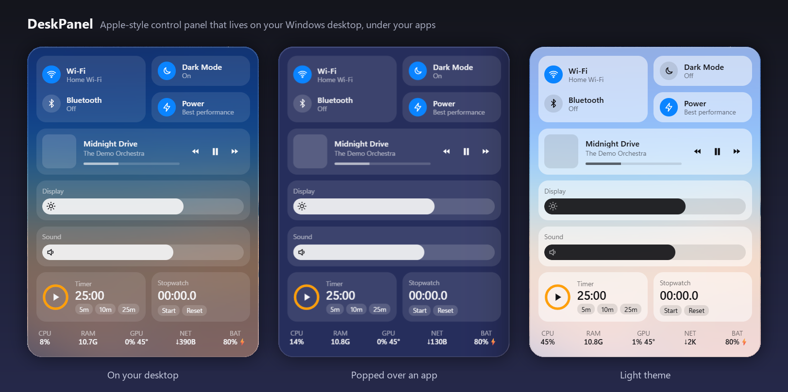
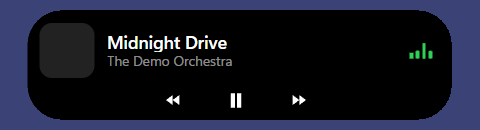
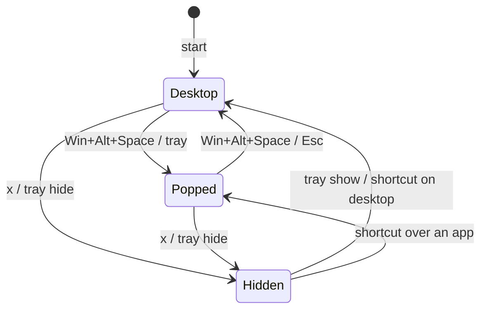
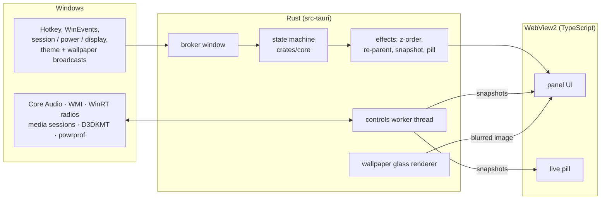

<div align="center">

# DeskPanel

**An Apple-style frosted-glass control panel that lives *on your Windows 11 desktop*, underneath your apps.**

It never covers Chrome. Press **Win+Alt+Space** to lift it above everything, press it again to send it back.

[](#install)
[](https://tauri.app)
[](#how-its-built)
[](#performance)
[](#performance)
[](LICENSE)



[**Download**](../../releases/latest) · [Features](#features) · [How it works](#how-its-built) · [Performance](#performance) · [Build it](#build-from-source)

</div>

---

## Why

A floating control panel is great while you're looking at the desktop. The moment you switch to a browser it sits on top of the page and gets in the way. Every "always on top" widget has this problem.

DeskPanel turns that around. **It is part of the desktop layer**, like a wallpaper widget:

- Show the desktop and it's there, at a spot you chose.
- Open any app and the app covers it, with no flicker and no focus fights.
- Need it while working? **Win+Alt+Space** springs it on top of your app. Press the shortcut again to drop it back. Focus returns to where you were.

## Features

| | |
|---|---|
| **Frosted glass, drawn properly** | Blurred and saturated wallpaper glass on the desktop, a live-captured blurred snapshot when popped over apps. Dark and light follow Windows and switch in ~20 ms. |
| **Real controls, not mock-ups** | Volume and mute, brightness, Wi-Fi, Bluetooth, dark mode, power mode. Each one changes the actual Windows setting, and follows changes made elsewhere (the volume flyout, media keys). |
| **Now Playing** | Whatever is playing in Windows' media controls: the Spotify app, YouTube in a browser, and more. Album art, progress, previous / play-pause / next. |
| **Timer and stopwatch** | Ring timer with presets, scroll-to-set minutes, laps. Still fires with the panel hidden, with a notification and a sound. |
| **System stats** | CPU, RAM, GPU load and temperature, network speed, battery. GPU numbers come from the graphics kernel, so reading them never wakes a sleeping NVIDIA GPU. |
| **Dynamic-Island-style pill** | A small black pill at the top of the screen shows your timer or track while the panel is covered. Hover to expand it. It stays out of fullscreen apps and never blocks clicks around it. |
| **Springs at 144 Hz** | Appear, pop, drop and hover animations run on the compositor from real spring physics. 144 fps with no frame over 16.7 ms across 160 recorded runs. |
| **Light on the machine** | ~0.014 % CPU and ~98 MB RAM while hidden. It pauses its stats loop and shrinks its webview when it can't be seen. |
| **Polite** | No admin rights. Doesn't appear in Alt+Tab or the taskbar. Never takes keyboard focus unless you pop it. Survives Explorer restarts. |

<div align="center">

&nbsp;&nbsp;&nbsp;

<br><sub>The live pill, collapsed and expanded on hover.</sub>
</div>

## Install

**Requirements:** Windows 11 (built and tested on build 26300). WebView2 is already part of Windows 11.

1. Download **`DeskPanel_0.1.0_x64-setup.exe`** from the [latest release](../../releases/latest).
2. Run it. It installs for your user only, so there is no admin prompt.
3. Windows SmartScreen may say *"Windows protected your PC"*, because the installer isn't code-signed. Click **More info → Run anyway**. You can check it first: the code is all here, and the build is reproducible from this repo.
4. DeskPanel appears on the right side of your desktop. It starts with Windows from then on (turn that off in the tray menu).

**Uninstall:** Settings → Apps → DeskPanel. Your settings stay in `%APPDATA%\DeskPanel` unless you delete that folder.

## Use it

| To… | Do this |
|---|---|
| See the panel | Show the desktop (Win+D, or minimize your apps) |
| Bring it over your apps | **Win+Alt+Space**, or left-click the tray icon |
| Send it back | **Win+Alt+Space** again, or **Esc** while it has focus |
| Hide it completely | the **×** at its top-right (shows on hover). Bring it back with the shortcut or the tray |
| Move it | drag any empty part of it. The position is remembered |
| Quit, autostart, pill on/off, open config | right-click the tray icon (it lives in the **^** overflow by default) |

Sliders: click, drag or scroll. Click the speaker icon to mute. Timer: click the ring, use the 5/10/25 chips, or scroll over the digits to set minutes.

## How it's built

The interesting part of this project is *keeping a window pinned to the desktop layer* on a recent Windows 11 build, because none of the obvious approaches survive contact with real behaviour. Everything below was found by measuring, not assuming.

### 1. It's a child of the desktop window
| Approach | Result |
|---|---|
| Keep it at the bottom of the z-order (`HWND_BOTTOM`) | goes **behind the desktop** after Win+D |
| Make the desktop its *owner* | **steals focus** on click and stays above apps after Win+D |
| **Make it a child of `Progman`** (the desktop window) | ✅ survives Win+D, covered by every app, doesn't take focus |

Popping is the reverse trip: re-parent to a top-level topmost window, take focus (allowed right after a hotkey), and hand focus back on drop.

### 2. The glass is drawn, not requested
Windows' own Acrylic turns flat grey when a window isn't focused, and this panel is never focused. Behind a desktop-layer window there is only the wallpaper, so DeskPanel **renders the wallpaper itself**: laid out exactly as Windows lays it out, downscaled, blurred and saturated once in Rust, then offset in CSS so it lines up pixel-for-pixel (0 px lag measured while dragging). When popped over an app, a **screen capture of what's behind** replaces it. The panel is briefly excluded from capture instead of hidden, so there's no blink.

### 3. It survived a change in how Windows draws the desktop
After one reboot on this Insider build, Explorer began rendering the desktop through DirectComposition. Two things broke: transparent child windows rendered **black**, and clicking the desktop **activated Explorer and stole focus from your app**. Fixes: clip the desktop-mode window to the exact panel shape (with a 4 px ring of real wallpaper for smooth edges), and detect the activation and hand focus straight back within 15–35 ms. Both modes are handled, and the original test spike was kept to prove the OS had changed, not the code.

### 4. A pure, tested state machine
All show / hide / pop / drop logic is a Win32-free Rust crate ([`crates/core`](crates/core/src/state.rs)): `step(Input) -> Vec<Effect>`. The OS layer only translates events into inputs and executes effects. 19 unit tests cover every state × input pair, inputs arriving mid-animation, effect ordering (the pop animation starts *before* the re-parent, which is what makes it feel instant), and the pill rule.



### 5. Robustness details that took real debugging
- **Explorer restart** destroys the desktop window *and your child window with it*. DeskPanel notices, rebuilds the webview, re-parents it and carries on in under half a second. All state lives in Rust, so nothing is lost.
- **Animation completion** is double-protected (a webview timeout plus a Rust watchdog), so a hung webview can never leave the panel stuck on top of your apps.
- **Tray menus** need their owner window to hold focus. A naive focus guard closed the menu instantly, so it only polices the panel and pill windows.
- **Idle cost:** an occlusion detector samples a 24×32 grid of the panel against the window z-order. A covered or hidden panel stops its stats worker and lowers WebView2's memory target.

### Architecture



## Performance

Measured on the release build, private working set including every WebView2 process:

| State | CPU | RAM |
|---|---|---|
| Hidden (300 s) | **0.014 %** | 98 MB |
| Covered by an app | 0.055 % | 100 MB |
| Visible on the desktop, stats ticking | 0.25 % | 97 MB |
| Hidden, pill showing a playing track | 0.41 % | 93 MB |

| Interaction | Measured |
|---|---|
| Hotkey → pop animation starts | **2 ms** |
| Animation frame times (160 runs, 144 Hz) | 0 frames over 16.7 ms |
| Windows theme change → panel repaints | 18–34 ms |
| Explorer restart → panel back | 472 ms |
| Installer / exe size | 1.4 MB / 4.2 MB |

## Verification

This project was built against a written definition of done: [`docs/SPEC.md`](docs/SPEC.md) and a 64-item, binary [`docs/CHECKLIST.md`](docs/CHECKLIST.md). Each item was checked on a real machine by scripts that **drive the real desktop** (synthetic input, window hit-testing, screenshots) and read results back through *independent* code paths (separate Core Audio / WMI / registry / WinRT reads).

- **43 of 64 items pass with recorded evidence.** The rest need a human (watching for tearing, hearing the timer, changing display scaling, sleep / lock / sign-in) or are long runs; they are listed plainly in the checklist.
- The test scripts are in [`scripts/`](scripts/). The Stage 1 feasibility spike is in [`spike/`](spike/).

> **Honest scope:** tested on one laptop (Windows 11 build 26300, single 1920×1080 screen at 125 %, 144 Hz). Other hardware may behave differently. Issues and reports are welcome.

## Config

`%APPDATA%\DeskPanel\config.json`: tray → *Open config file*, then restart DeskPanel.

| Key | Default | Meaning |
|---|---|---|
| `position` | `null` | panel top-left in physical px; `null` = right edge, centered |
| `hidden` | `false` | hidden with × (kept across restarts) |
| `pill_enabled` | `true` | live pill on/off |
| `autostart` | `true` | start with Windows (per-user Run key) |
| `blur_px` | `40` | glass blur radius |
| `saturate` | `1.8` | glass color boost |

Set `DESKPANEL_DEMO=1` to show sample data instead of your real Wi-Fi name and music (used for the screenshots above). Logs: `%APPDATA%\DeskPanel\logs\events.log`.

## Limitations

- **The desktop glass is your wallpaper, blurred.** Desktop icons under the panel don't show through, and there's no drop shadow on the desktop. When popped, the glass is a snapshot, so a video playing behind won't move in the blur.
- **Single monitor** by design.
- **Not possible without admin or a public API:** CPU temperature, airplane mode, Night light, Do Not Disturb.
- **Hardware-dependent:** brightness needs a laptop panel; Wi-Fi / Bluetooth toggles depend on the driver; GPU stats prefer an NVIDIA GPU and fall back to the first adapter.
- **Insider builds** can change how the desktop window works between flights. DeskPanel already copes with two desktop rendering modes.
- **Unsigned installer:** SmartScreen will warn on first run.

## Build from source

Requirements: Node 20+, Rust (MSVC toolchain), Visual Studio Build Tools with the C++ workload.

```powershell
npm install
npm run app:exe        # release exe -> target\release\deskpanel.exe
npm run app:release    # + NSIS installer -> target\release\bundle\nsis\
cargo test -p deskpanel-core    # the state-machine tests
```

## Project layout

```
crates/core/    the show/hide state machine (pure Rust, unit-tested)
crates/probe/   test probe: hit-testing, screenshots, synthetic input
src-tauri/      Windows integration: desktop layer, hotkey, controls, tray, glass
src/            the panel and pill UI (TypeScript + CSS, no framework)
scripts/        the scripts that drive the real desktop to verify behaviour
docs/           spec, checklist, screenshots
spike/          the Stage 1 feasibility spike (z-order strategies)
```

## License

[MIT](LICENSE). Built with [Tauri](https://tauri.app), the [`windows`](https://github.com/microsoft/windows-rs) crate and a lot of measuring.
